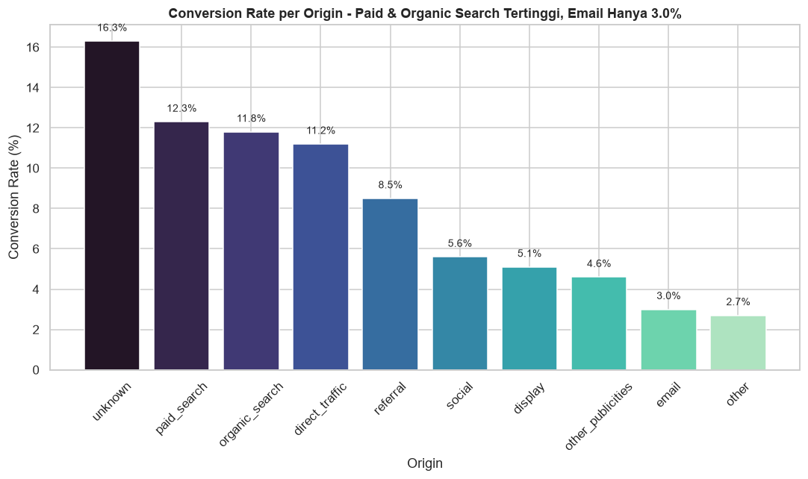
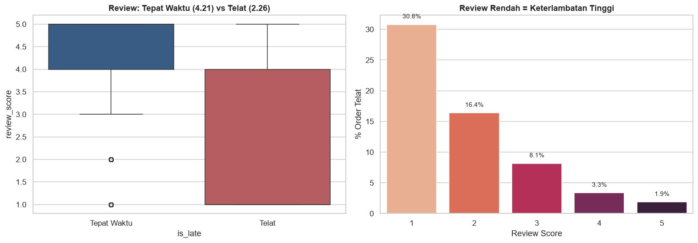
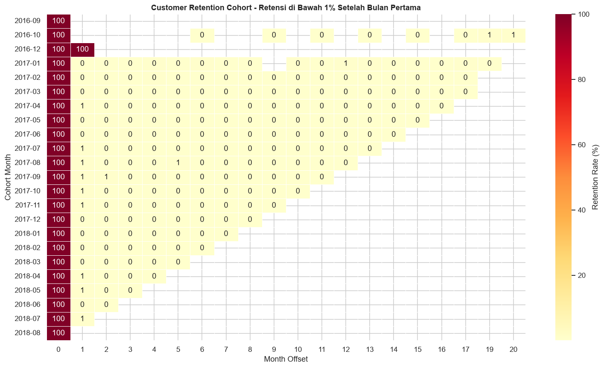
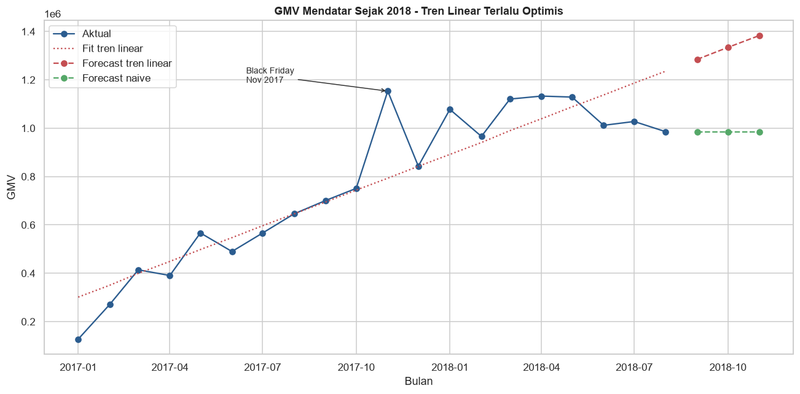

# Olist E-Commerce: GMV Analysis from Marketing, Logistics and Forecasting

We built this project for the Data Analytics competition at TechFest, organized by HIMTI BINUS, under the theme "Business". It uses the public Olist datasets from Brazil (about 99k orders from 2016 to 2018, plus 8,000 marketing qualified leads) to look at GMV (Gross Merchandise Value) from three sides: where sellers come from, how delivery performance affects customers, and what monthly GMV looks like going forward.

This version was revised after the competition: the forecasting section was added, insight text that did not match the output was corrected, and known issues are documented below.

The full analysis is in [notebooks/olist_gmv_analysis.ipynb](notebooks/olist_gmv_analysis.ipynb). The notebook text is in Indonesian.

## Business questions

1. **Marketing / traffic:** Which marketing channels bring in sellers who actually convert, and how does that relate to GMV?
2. **Operations / logistics:** How do late deliveries and review scores relate to GMV?
3. **Forecasting:** What does the monthly GMV trend look like in the coming months, based on sales history?

## Methodology

- **Data validation:** missing values per table, date conversion, delivery delay (actual vs estimated date), price range check.
- **Marketing funnel:** lead volume and lead-to-seller conversion rate per acquisition channel (`origin`).
- **Statistical test:** one-way ANOVA comparing review scores of on-time and late orders.
- **RFM segmentation:** recency, frequency and monetary scores (quintiles) per `customer_unique_id`, grouped into seven segments.
- **Cohort analysis:** monthly acquisition cohorts and retention by month offset.
- **Machine learning:** Random Forest regressor on order-level GMV with feature importance (see limitations).
- **Forecasting:** monthly GMV from January 2017 to August 2018, linear trend vs a naive baseline, evaluated on the last 3 months as a holdout, then a 3-month forecast. This part was added after the competition to answer question 3.

## Key findings

All numbers come from the notebook output.

**Marketing**
- Organic search is the largest lead source (28.9% of 8,000 leads), followed by paid search (20.0%) and social (17.0%).
- Search converts best: paid search 12.3% and organic search 11.8% of leads became sellers. Email converts at only 3.0%, and social at 5.6% despite being the third largest source.
- Leads with `origin = unknown` convert at 16.3%, which suggests tracking gaps rather than a real channel.



**Logistics**
- About 6.6% of orders arrived after the estimated date (6.5% in the review-matched data). On average, orders arrived 11.9 days earlier than estimated.
- Late orders get an average review score of 2.26, compared with 4.21 for on-time orders. The difference of 1.95 points is significant (ANOVA F = 15,964.4, p < 0.0001).
- 30.8% of 1-star reviews come from late orders, compared with 1.9% of 5-star reviews.



**Customers**
- 93,358 customers in the RFM table. Almost all of them ordered only once (the 75th percentile of frequency is 1, the maximum is 15).
- Champions have the highest average spend (184), but the gap to other segments is small (165 to 180).
- After the first month, retention for almost every cohort is between 0.2% and 0.7%.



**Forecasting**
- Monthly GMV grew quickly through 2017 (from 127k in January to 751k in October, with a Black Friday peak of 1.15M in November, up 54% from October) and then stayed flat between roughly 0.97M and 1.13M per month in 2018.
- On the June to August 2018 holdout, the naive baseline (last month's value) had a MAPE of 12.0%, while the linear trend had 34.2%. The linear trend keeps extending 2017 growth and overshoots.
- The 3-month naive forecast is about 985k per month. The linear trend forecasts 1.29M to 1.38M, which the holdout suggests is too optimistic.



## Recommendations

1. **Fix delivery delays first, starting with high-value orders.** Late delivery is the clearest driver of bad reviews in the data.
2. **Push the second order.** With retention under 1%, a voucher or follow-up in the first 30 days after delivery has more room to help than anything aimed at loyal customers.
3. **Focus seller acquisition on search.** Keep investing in both organic and paid search, review the email and social budgets, and clean up channel tracking so fewer leads end up as "unknown".
4. **Use RFM segments for targeting with care.** Win-back for At Risk (14,803 customers) and referral offers for Champions (14,961) make sense, but the segments are mostly driven by recency and spend because almost nobody buys twice.
5. **Plan GMV targets and stock on a flat baseline**, with extra capacity for November.

## Known limitations

These issues are in the original competition logic. We kept the logic and numbers unchanged and documented them here.

- **GMV double counting in section 5.** Orders are joined to payments and items at the same time, so orders with more than one payment row get their items counted more than once. Total delivered GMV shows as 16,114,163 instead of 15,419,774 (about 4.5% higher), and "Total order: 118,434" is a row count, not an order count. RFM monetary values inherit this. The forecasting section builds GMV directly from order items and is not affected.
- **Target leakage in the Random Forest.** The target `gmv` is `price + freight_value`, and both columns are features. The model reaches R² = 1.000, which only means it learned to add two columns. Its feature importance should not be read as a business finding.
- **RFM frequency score.** Because almost every customer has one order, the F score is assigned by row order (`rank(method='first')`), so it carries little information.
- **Questions 1 and 2 are only partly answered.** The notebook measures channel conversion but does not follow converted sellers into GMV (possible through `closed_deals.seller_id`), and it does not break GMV or delays down by region (`customer_state`).
- **Forecasting is a simple baseline.** Twenty monthly points and a 3-month holdout are not enough for seasonal models. The result should be read as "GMV was flat in 2018", not as a precise prediction.

## How to run

1. Clone the repository and install the dependencies (Python 3.11 or newer; tested on 3.14.6):

   ```bash
   git clone https://github.com/Jirosann/olist-ecommerce-gmv-analysis.git
   cd olist-ecommerce-gmv-analysis
   python -m venv .venv
   .venv/Scripts/activate        # Windows; use "source .venv/bin/activate" on macOS/Linux
   pip install -r requirements.txt
   ```

2. Download the Olist CSV files and place them as described in [data/README.md](data/README.md).
3. Open the notebook from the `notebooks/` folder and run all cells, or run it from the command line:

   ```bash
   jupyter nbconvert --to notebook --execute --inplace notebooks/olist_gmv_analysis.ipynb
   ```

The notebook reads data from `../data/` relative to its own folder. All random processes use `random_state = 42`.

## Repository structure

```
olist-ecommerce-gmv-analysis/
├── notebooks/
│   └── olist_gmv_analysis.ipynb   # full analysis with outputs
├── data/
│   └── README.md                  # where to download the data and where to put it
├── images/                        # charts exported from the notebook output
├── requirements.txt
└── README.md
```

## Team

Built by team Inilah4Trio (Muhammad Nabil Al Qadri, El Husamy Ahmad, Joshua Alessandro P). We worked together on a single machine, sharing the dataset research, coding and analysis. The post-competition revision in this repo was done by Muhammad Nabil Al Qadri.

## Data and license

Dataset attribution:

- Brazilian E-Commerce Public Dataset by Olist, CC BY-NC-SA 4.0: https://www.kaggle.com/datasets/olistbr/brazilian-ecommerce
- Marketing Funnel by Olist, CC BY-NC-SA 4.0: https://www.kaggle.com/datasets/olistbr/marketing-funnel-olist

The CSV files are not included in this repository. Monetary values are in Brazilian real (BRL).

---

## Ringkasan (Bahasa Indonesia)

Proyek lomba Data Analytics TechFest HIMTI BINUS (tema Business) dengan dataset publik Olist. Kami menganalisis GMV dari tiga sisi: channel pemasaran untuk akuisisi seller, dampak keterlambatan pengiriman terhadap review, dan peramalan GMV bulanan.

- Organic search sumber lead terbesar (28,9%), tapi konversi tertinggi ada di paid search (12,3%) dan organic search (11,8%). Email hanya 3,0%.
- Order yang telat mendapat review rata-rata 2,26, dibanding 4,21 untuk yang tepat waktu (ANOVA, p < 0,0001).
- Hampir semua pelanggan hanya belanja sekali; retensi setelah bulan pertama hanya 0,2 sampai 0,7%.
- GMV bulanan mendatar sepanjang 2018. Baseline naive (MAPE 12,0%) lebih akurat daripada tren linear (34,2%), dengan proyeksi sekitar 985 ribu per bulan.

Keterbatasan (GMV terhitung ganda sekitar 4,5% di bagian merge, leakage pada model Random Forest, dan skor frequency RFM) dijelaskan di bagian "Known limitations".
